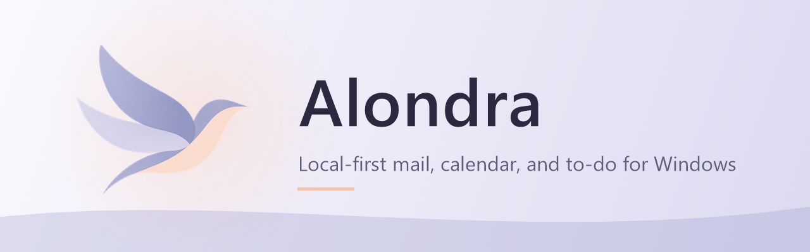
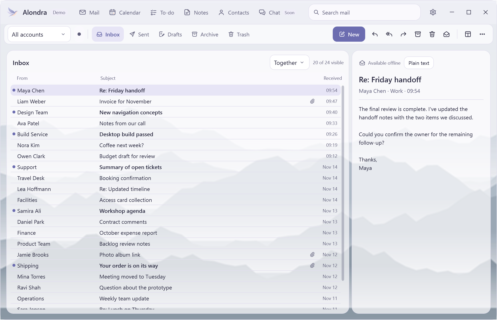
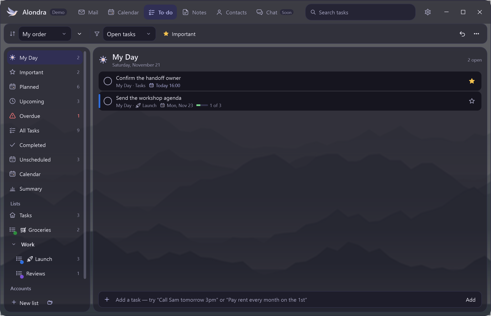

<p align="center">
  
</p>

**Alondra1** is a calm, lightweight Windows app for your mail, calendar, tasks, notes, and contacts.

- **Local-first.** Your settings, local mail, and tasks live on your PC, and the To-do workspace works with no account or network at all.
- **Private.** Alondra1 has no servers, no telemetry, and no ads. It connects only to the mail accounts you add.

<p align="center">
  
  
</p>

## Highlights

- **Mail:**
  - Microsoft 365, Gmail, and any IMAP, POP3, or SMTP provider.
  - Each account can be *Online* (server only) or *Personal* (full offline copy with search).
  - Safe sending that never duplicates a message.
  - Dockable layout.
- **To-do:** lists and groups, steps, due dates, repeats, reminders, natural-language quick add, smart views, a task calendar, undo, and backup, import, and export. All of it works offline.
- **Calendar, Notes, Contacts:** from your connected Microsoft 365 or Google accounts.
- **Your look:** light and dark themes in the Alondra1 lavender palette, custom colors, and background pictures that are processed on your PC.
- **Simple install:** a per-user setup with no administrator prompt. Updates and uninstalls never touch your data.

See [docs/FEATURES.md](docs/FEATURES.md) for the complete list.

## Install

Run `artifacts/Alondra1-setup.exe`, or build it yourself as shown below. It installs to `%LOCALAPPDATA%\Programs\Alondra1` and adds a Start menu shortcut and an entry in Settings → Apps.

Your data lives in `%LOCALAPPDATA%\alondra1`. Installing a newer version or uninstalling keeps it.

On first launch, choose sample data, import a configuration, or add an account. For Microsoft 365 or Gmail sign-in, register a free public OAuth client first ([docs/OAUTH-SETUP.md](docs/OAUTH-SETUP.md)).

## Build from source

You need the .NET 10 SDK on Windows. For the setup program you also need Inno Setup 6.

```powershell
cd apps/windows                                     # the Windows app (.NET 10 / WPF)
dotnet build Alondra1.slnx                          # build
dotnet test Alondra1.slnx                           # run the tests
dotnet run --project src/Alondra1.App -- --demo     # try it with sample data
./installer/publish.ps1                            # self-contained build + apps/windows/artifacts/Alondra1-setup.exe
```

`--demo` uses labeled sample data in a temporary folder and never contacts a provider.

## Documentation

| Document | For |
| --- | --- |
| [Features](docs/FEATURES.md) | Everything Alondra1 does today, by workspace, and the known gaps. |
| [Architecture](docs/ARCHITECTURE.md) | Projects, ports and adapters, sync, storage, security, threading. |
| [Code guide](docs/CODE-GUIDE.md) | File-by-file reference, common changes, command-line switches, tests. |
| [Guidelines](docs/GUIDELINES.md) | Principles and rules for code, data, security, UI, testing, and releases. |
| [UI design](docs/UI-DESIGN.md) | Design tokens, palette, icons, responsive behavior, backgrounds. |
| [To-do](docs/TODO.md) | The local task engine in depth: entities, storage, behavior, formats, shortcuts. |
| [OAuth setup](docs/OAUTH-SETUP.md) | Registering Microsoft and Google clients. |
| [Delivery notes](docs/DELIVERY-NOTES.md) | Release history and what was verified. |
| [Backend spec](docs/BACKEND_SPEC.md) | The optional cloud (in progress): [decisions](docs/decisions), [Compose runbook](docs/runbooks/compose.md), [API](backend/README.md), [shared contract](packages/README.md). |

## Repository

This is a monorepo. The Windows app is in [`apps/windows`](apps/windows). The optional cloud API is in [`backend`](backend) (Go, PostgreSQL, Docker Compose); it provides sign-in, spaces (Personal, Family, Organization), and private task and settings storage so far, and the Windows app does not use it yet. [`packages`](packages) holds the API contract and the task schema shared by all clients.

## Logo


The Alondra1 bird is in [`docs/images`](docs/images):
- transparent PNGs at 64, 512, and 1024 px;
- the README banner.

The app icon is `apps/windows/src/Alondra1.App/Assets/alondra1.ico`. The banner and the setup wizard artwork are generated by `apps/windows/installer/branding/make-branding.ps1`.
