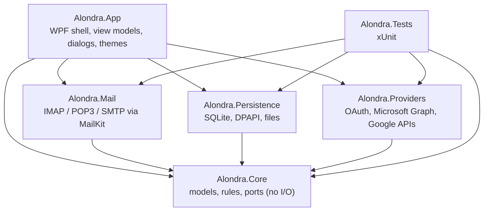

# Architecture

Alondra is a Windows desktop app (WPF, .NET 10) for mail, calendar, tasks, notes, and contacts. It is **local-first**:

- Settings, the local mail copy, local tasks, and credentials live in one folder in the user's profile.
- Nothing is sent anywhere except to the mail and organizer accounts the user adds.
- There is no Alondra server, telemetry, or cloud sync.

This page explains how the code is organized and how data moves through it. [CODE-GUIDE.md](CODE-GUIDE.md) is the file-by-file reference, and [GUIDELINES.md](GUIDELINES.md) has the rules for changing it.

## Projects

| Project | Target | Depends on | Responsibility |
| --- | --- | --- | --- |
| `Alondra.Core` | `net10.0` | nothing | Domain models, configuration schema, sync and security policies, the local task engine, and the **ports** (interfaces) that the other projects implement. No UI, file, database, or network code. |
| `Alondra.Mail` | `net10.0` | Core, MailKit | `MailKitGateway` implements `IMailGateway`: probing, folder listing, incremental fetch, bodies, attachments, flags and moves, IDLE, POP deletion, SMTP send. |
| `Alondra.Persistence` | `net10.0-windows` | Core, Microsoft.Data.Sqlite, ProtectedData | `SqlitePersonalStore` (local mail copy with FTS5 search, outbox, organizer cache), `SqliteTaskStore` (local tasks), `DpapiSecretStore`, `ConfigFileStore`, `AttachmentFiles`, `TaskFileStore`. |
| `Alondra.Providers` | `net10.0` | Core, MSAL, Google.Apis.Auth | `OAuthService` (sign-in and token refresh for Microsoft 365 and Google) and `OrganizerGateway` (calendar, tasks, contacts, notes over Microsoft Graph and Google APIs). |
| `Alondra.App` | `net10.0-windows` (WPF) | all of the above, CommunityToolkit.Mvvm | Window shell, workspaces, view models, dialogs, themes, icons, backgrounds, reminders, and the composition root. Builds `Alondra.exe`. |
| `Alondra.Tests` | `net10.0-windows` | Core, Mail, Persistence, Providers | Acceptance, To-do, scale, and UI design tests. The UI tests read the XAML from the repository instead of referencing the App project. |

**The dependency rule:** only `Alondra.App` knows every project. Adapters depend on `Alondra.Core`, never on each other, and `Alondra.Core` depends on nothing. Mail, storage, and providers can each be replaced or faked in tests without touching the rest.

## Ports and adapters

Ports are declared in `Alondra.Core/Ports/Ports.cs`, except `ITaskStore`, which is in `Alondra.Core/Tasks/TaskBoard.cs`.

| Port | Adapter | Notes |
| --- | --- | --- |
| `IMailGateway` | `Alondra.Mail.MailKitGateway` | Stateless: every call gets the account and its secrets. |
| `IPersonalStore` | `Alondra.Persistence.SqlitePersonalStore` | `personal.db`. Writes arrive as one `PersonalBatch` per transaction. |
| `ISessionCache` | `Alondra.Core.Ports.SessionCache` | In-memory messages and bodies for Online accounts. |
| `ISecretStore` | `Alondra.Persistence.DpapiSecretStore` | One DPAPI-protected file per account under `secrets\`. |
| `ITokenRefresher` | `Alondra.Providers.OAuthService` | Refreshes Exchange and Graph tokens separately (`TokenAudience`). |
| `IOrganizerGateway` | `Alondra.Providers.OrganizerGateway` | Calendar, tasks, contacts, and notes in the user's Microsoft or Google account. |
| `ITaskStore` | `Alondra.Persistence.SqliteTaskStore` | `todo.db`. |
| `IClock` | `Alondra.Core.Ports.SystemClock` | Tests pass a fixed clock. |
| `IConflictSink` | `NullConflicts` (App) | Reports when both copies of a conflicting item were kept. |

## Composition and startup

1. `App.OnStartup` (`App.xaml.cs`) reads the command line and installs a crash handler that writes `logs\crash.txt`. It then calls `AppServices.CreateAsync(home)`.
2. `AppServices` (at the end of `ViewModels/MainViewModel.cs`) is the **composition root**. It creates the data folder, loads `config.json`, opens `personal.db` and `todo.db`, and wires every adapter into `SyncCoordinator` and `TaskBoard`.
   - If `todo.db` cannot be opened (for example, a file written by a newer version), only the To-do workspace is disabled. Mail and the other workspaces keep working.
3. `MainWindow` creates the `MainViewModel` and applies the theme and background. On first launch with no accounts it shows the welcome dialog: sample data, import, or add an account.
4. `--demo` (and `--perf`) point `home` at a temporary folder filled with labeled sample data, so a demo never touches real settings.

## Accounts and modes

Each `AccountConfig` has a kind (`Microsoft365`, `Gmail`, `Manual`), incoming settings (IMAP or POP3), outgoing SMTP settings, an authentication kind (password or OAuth), and a **mode**:

| Mode | Where messages live | Typical use |
| --- | --- | --- |
| **Online** | Only in memory (`SessionCache`) while the app runs. Nothing from the mailbox is written to disk. | Light use: the server remains the only copy. |
| **Personal** | In `personal.db`, with full-text search, attachments on disk, and a durable outbox. | Offline reading, POP3 accounts, large mailboxes. |

Switching modes goes through `ModeTransition.Evaluate`, which refuses to drop queued operations unless the user confirms. Leaving Personal mode deletes that account's local rows.

## Mail synchronization

`SyncCoordinator` (`Alondra.Core/Sync`) runs all mail work for one account at a time behind a per-account `SemaphoreSlim`:

1. Load the secrets and ask `ConnectionPolicy` whether connecting is allowed.
   - Plaintext needs explicit confirmation.
   - OAuth tokens are never sent to an unencrypted server.
   - A missing password or token stops the sync with a readable reason.
2. Refresh tokens through `ITokenRefresher`. Provider errors are translated by `ProviderDiagnostics`.
3. Fetch changes per folder with a stored checkpoint.
   - **IMAP:** `ImapReconciler` resets the local folder when `UIDVALIDITY` changes.
   - **POP3:** `Pop3Policy` deduplicates by UIDL. It deletes from the server only when the user enabled that, consented, and the local commit is durable.
4. Online accounts write into the `SessionCache`. Personal accounts commit one `PersonalBatch` per transaction.

**Sending** goes through `SmtpStateMachine`:
- A failure before the server accepted the message is retried automatically, with backoff.
- A connection lost after the message was handed over is **Uncertain**. It is kept in the outbox and never resent automatically, because that could send the same mail twice.
- `SentCopyPolicy` decides whether Alondra appends a copy to Sent or the provider already does.
- `MessageIdentity` gives every message a stable `Message-ID` (`…@alondra.local`) so a retry can be recognized.

Local actions (read or unread, archive, delete, move) are applied locally first. For Personal accounts they are queued as `QueuedOperation`s and replayed against the server. `ConflictPolicy` resolves an item changed on both sides:
- a draft body changed in both places keeps both versions;
- flags changed in both places are merged;
- otherwise the side that changed wins.

## Organizer: calendar, notes, contacts, account tasks

`OrganizerGateway` talks to Microsoft Graph and to the Google Calendar, Tasks, People, and Drive APIs:
- Features are turned on per installation (Settings → Connections → Features).
- `GetStatusAsync` reports a `CapabilityStatus`, for example "consent missing", instead of failing silently.
- Notes are stored as files in the provider's **app folder** (OneDrive app folder or Drive app data), not OneNote or Keep.
- For Personal accounts, organizer items are cached in `personal.db`.

The Calendar workspace shows account events. Local task dates appear in the To-do workspace's own calendar.

## Local To-do

The To-do workspace works without any account or network access.

| Layer | Types |
| --- | --- |
| Domain (`Alondra.Core/Tasks`) | `TaskBoard` (the single entry point for changes), `TodoModels`, `Recurrence`, `Reminders`, `TaskQueries` (smart views, search, sort), `NaturalDateParser`, `TodoTransfer` (JSON, CSV, iCalendar) |
| Persistence | `SqliteTaskStore` (versioned migrations, online backup and restore), `TaskFileStore` (copied attachments) |
| Presentation (`Alondra.App/Tasks`) | `TodoViewModel`, `TodoView`, `TodoToolbar`, `TodoDialogs`, `TodoDataActions`, `TodoPrinter`, `ReminderNotifier` |

A change runs in this order:
1. `TaskBoard` builds a `TodoChangeSet` and its inverse.
2. It writes the change set in **one SQLite transaction**.
3. Only after that succeeds does it update memory and raise `Changed`.

If the write fails, memory stays as it was. The inverse goes onto a 50-step undo stack. [TODO.md](TODO.md) has the full design.

## User interface

| Part | Where | What it does |
| --- | --- | --- |
| Shell | `MainWindow.xaml(.cs)` | Two rows above the content: the header (logo, workspaces, search, Settings, window buttons) and a toolbar for the open workspace. The window is borderless (`WindowStyle="None"`) and draws its own caption and window buttons. |
| View model | `ViewModels/MainViewModel.cs` | Workspace selection, accounts, folders, message list, reading pane, calendar, notes, contacts, sync status, responsive breakpoints. |
| Mail layout | `Shell/MailDockPanel.cs`, `Core/Layout/LayoutArranger.cs` | Docks the folders, list, and reader on any edge, giving 25 combinations, with resizable splitters. `LayoutArranger` holds the geometry and is unit-tested. |
| Theme | `ThemeService.cs`, `Themes/Light.xaml`, `Themes/Dark.xaml`, `Themes/Controls.xaml` | Color tokens per theme, shape and size tokens, and the control styles. The user can override colors. |
| Title bars | `Shell/ShellWindow.cs` | Colors native dialog title bars (DWM) to match the theme. |
| Icons | `Themes/Icons.xaml`, `Controls/AlondraIcon.cs` | 62 stroke icons drawn from SVG path data. |
| Backgrounds | `Shell/BackgroundService.cs`, `Shell/BackgroundEditor.cs` | Built-in and custom pictures, processed locally (scale, blur, tone). |
| Dialogs | `Dialogs.cs`, `Tasks/TodoDialogs.cs` | Built in code on one shared frame: welcome, settings, account, compose, import, palette editor, alerts. |
| Snapshots | `Shell/Snapshot.cs` | `--snapshot` renders the window to a PNG for docs and visual checks. |

[UI-DESIGN.md](UI-DESIGN.md) covers the design system.

## Data folder

Everything Alondra stores is under `%LOCALAPPDATA%\alondra`:

| Path | Contents |
| --- | --- |
| `config.json`, `config.json.bak` | Settings and accounts (no secrets). The previous good file is kept for recovery. |
| `secrets\` | Passwords and OAuth tokens, protected with Windows DPAPI for the current user. |
| `personal.db` | Local mail for Personal accounts, FTS5 search index, outbox, organizer cache. |
| `files\` | Downloaded mail attachments (pinned or cache). |
| `todo.db` | Local tasks, lists, groups, history, preferences. |
| `task-files\` | Files attached to local tasks (copies). |
| `backups\` | Daily to-do backups (`*.atodo`, last 7 kept) and safety copies made before a restore. |
| `backgrounds\` | The user's own background picture, re-encoded. |
| `logs\crash.txt`, `perf.txt` | Last unhandled error and `--perf` timing output. |

The installer puts the program in `%LOCALAPPDATA%\Programs\Alondra`. It never touches the data folder, so updating or uninstalling keeps all data.

## Security model

- **Secrets:** stored only in `secrets\`, encrypted with DPAPI (`CurrentUser` scope plus an app-specific entropy). They are never written to `config.json` or included in an export.
- **OAuth:** public clients only. Alondra never stores a client secret. The user enters their own client ids ([OAUTH-SETUP.md](OAUTH-SETUP.md)).
- **Transport:** implicit TLS or required STARTTLS by default, verified with the operating system's certificate check. Unencrypted connections need explicit, repeated confirmation (`ConnectionPolicy`).
- **Mail content:** HTML bodies are converted to plain text (`HtmlMailSanitizer.ToPlainText`). No scripts run and no remote content loads.
- **Files:** stored attachment paths are relative and checked to stay inside their folder before they are opened. Imported data is validated before anything is written.

## Threading and errors

- Libraries use `async` with `ConfigureAwait(false)`. The App resumes on the UI thread, so view-model state, `TaskBoard` changes, and `Changed` events all happen on the dispatcher.
- Sync for each account is serialized. Different accounts can sync in parallel.
- Expected failures (network, authentication, storage) become a status, such as "Offline" or "Sync failed", or a readable alert. An unhandled exception is written to `logs\crash.txt` and shown once before the app closes.

## Build and packaging

- `dotnet build Alondra.slnx` and `dotnet test Alondra.slnx`.
- `installer/publish.ps1` publishes a self-contained, single-file win-x64 build to `artifacts\win-x64`, then compiles `installer/alondra.iss` with Inno Setup 6 into `artifacts\Alondra-setup.exe`.
- The setup is per-user and needs no administrator rights. Its branded wizard artwork comes from `installer/branding/make-branding.ps1`.
