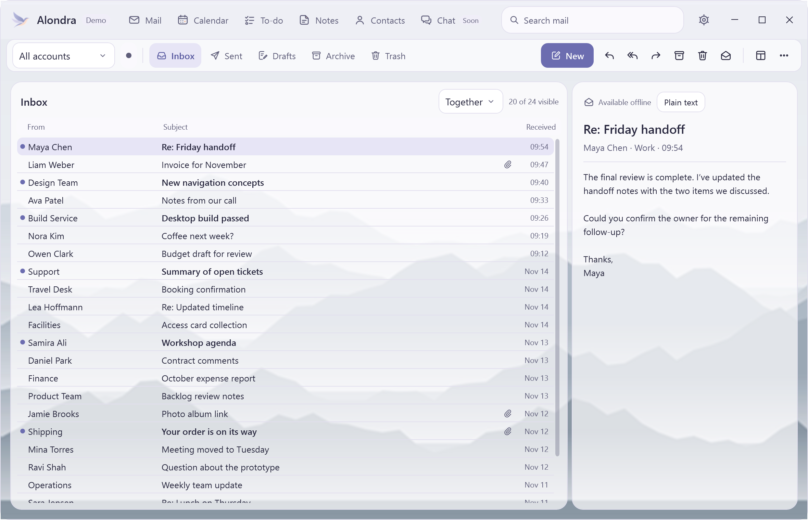
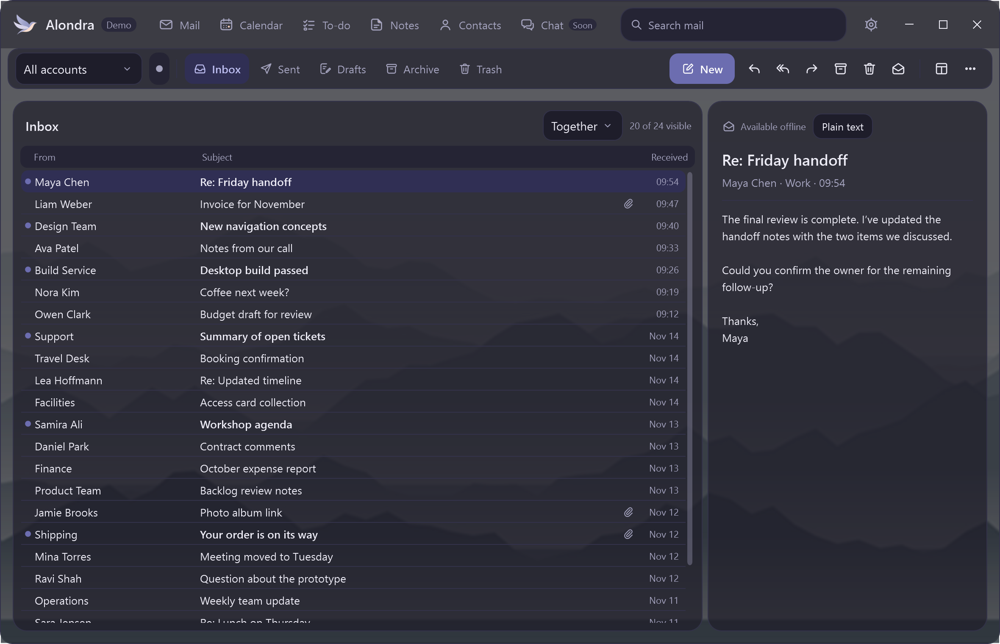
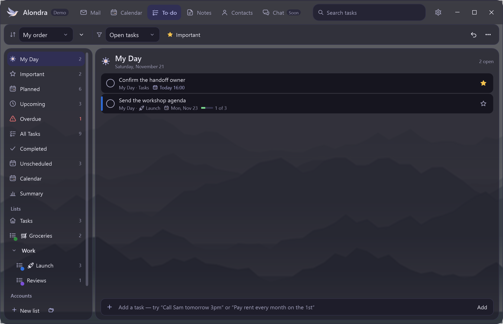
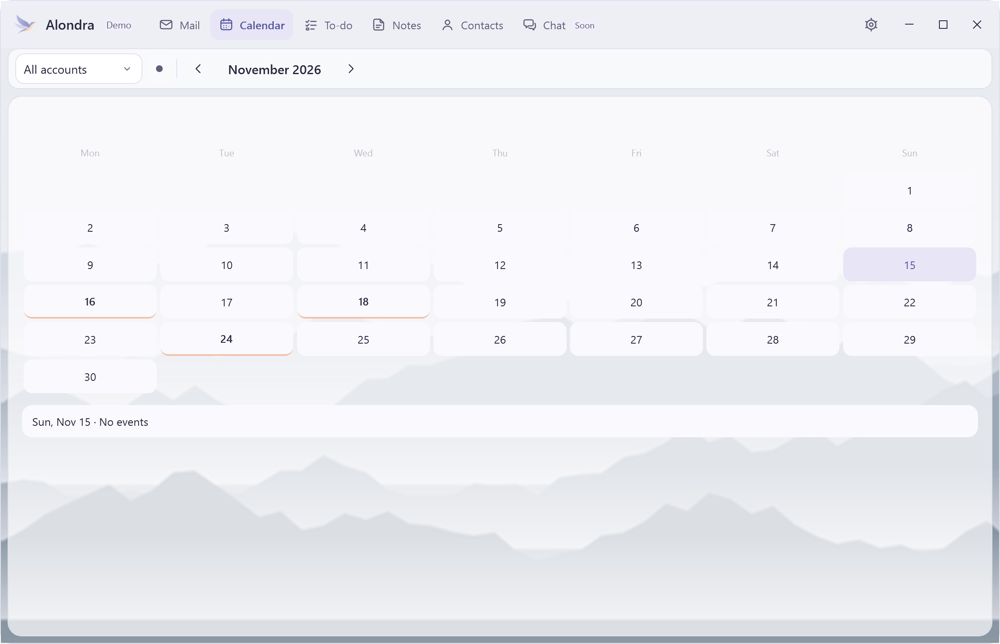
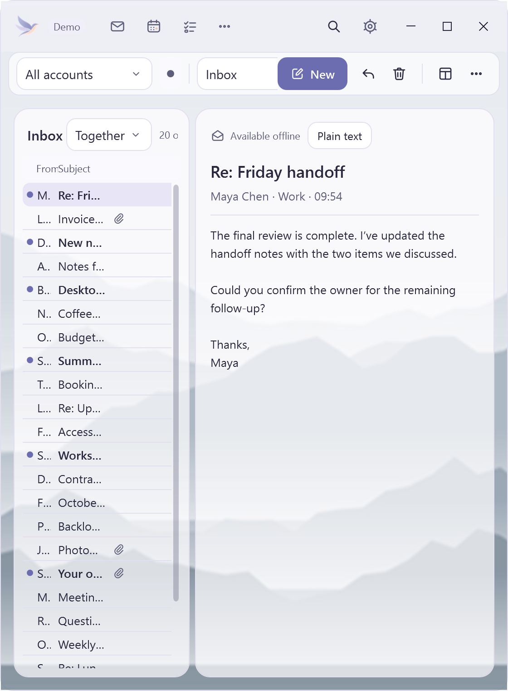

# UI design system

This describes the Alondra interface: the two-row shell, design tokens, the Alondra icon family, backgrounds, and what is still open.

| Light | Dark |
| --- | --- |
|  |  |
|  |  |
|  |  |

Narrow window (560 px): 

Screenshots are produced by the app itself: `Alondra.exe --demo --snapshot=<file.png> --exit`, optionally with `--open=<module>`, `--theme=dark`, and `--width=<px>`. They render the window's visual tree, so open popups and menus are not included.

## Shell: two rows above the content

| Row | Height | Contents |
| --- | --- | --- |
| Application header | 56 px | Logo and “Alondra” wordmark · Mail, Calendar, To-do, Notes, Contacts, Chat (Soon) · contextual search · Settings · window buttons |
| Module toolbar | 48 px | Mail: account selector with connection status, folder tabs, New / Reply / Reply all / Forward / Archive / Delete / Mark read or unread, Layout, More. Calendar: month navigation. To-do: sort, filter, important, undo, More. Notes: note selector, New note. Contacts: count. Chat: “Coming later”. |

The old module-navigation row, the “Mail” title, and the account/status text row are gone. Connection status (Up to date, Syncing…, Offline, Sync failed, Sample data, No accounts) is a colored dot with a label beside the account selector; the full text (account · mode · detail) is its tooltip and accessible name. Due task reminders float over the content as cards instead of occupying a row.

**Search** is one box whose meaning follows the module: “Search mail”, “Search tasks”, “Search contacts”. Calendar, Notes, and Chat have no search function, so the box is hidden there rather than offering a search that does nothing. Ctrl+E (or Ctrl+F) focuses it; Esc clears it.

**Folders:** with the Layout setting “Folders: Top” (the default) they are tabs in the toolbar. Left, Right, and Bottom still show the dockable folder pane, and Hidden shows a selector in the list header, so all 25 layout combinations keep working and folders are never shown twice.

### Narrow windows

The header and toolbar never wrap into another row. As the window narrows, in this order:

| Window width | Change |
| --- | --- |
| < 1240 | Status label hidden (dot remains, with tooltip) |
| < 1120 | Module labels hidden (icon buttons with tooltips and accessible names) |
| < 1040 | Reply all, Forward, Archive, Mark read move into the toolbar's More menu |
| < 960 | Folder tab labels hidden |
| < 760 | Folder tabs become a folder selector |
| < 720 | Search collapses to a search button that opens a search box |
| < 640 | Wordmark hidden (logo stays) |
| < 600 | Notes, Contacts, Chat move into a More menu in the header |
| < 560 | “New” label hidden (icon stays) |
| < 470 | Calendar and To-do also move into More |

The module that is open always stays visible in the header. In To-do, the list sidebar becomes a menu button under 720 px and the details pane floats over the list under 1000 px.

## Tokens

Defined in `src/Alondra.App/Themes/Controls.xaml` (shape) and `Light.xaml` / `Dark.xaml` (color).

| Radius | Value | Used for |
| --- | --- | --- |
| `RadiusSm` | 8 | chips, thumbnails, small components |
| `RadiusTip` | 8 | tooltips, menu and list rows |
| `RadiusMd` | 10 | buttons, inputs, selectors, active navigation |
| `RadiusLg` | 12 | toolbar, cards, popovers, menus |
| `RadiusXl` | 16 | main panels |
| `RadiusSearch` | 14 | header search |

Spacing follows 4 / 8 / 12 / 16 / 20 / 24 (panel padding 16, field gap 8, section gap 20). Controls: `ControlSm` 30 (compact buttons), `ControlMd` 36 (buttons, inputs, selectors), `ControlLg` 40 (header search, quick add), icon buttons 34 x 34. `HeaderHeight` 56, `ToolbarHeight` 48. Type: 16 titles, 14 body and input text, 13 buttons and list rows, 12 labels and helper text.

| Color token | Light | Dark | Role |
| --- | --- | --- | --- |
| ChromeBrush | #F6F4FA | #16151F | application base (lavender-tinted) |
| SurfaceBrush | #FFFFFF | #1E1D2A | popups, inputs (always opaque) |
| PanelBrush | #FFFFFF | #1E1D2A | main panels; about 69% opaque when a background picture is on |
| HeaderScrimBrush | transparent | transparent | 45% of the base color behind the header when a picture is on |
| SubtleBrush | #FAF9FD | #252434 | toolbar fields, cards |
| TextBrush | #2A2940 | #ECEBF5 | text (deep indigo slate / near white) |
| MutedBrush | #5F5E7A | #A4A3BE | secondary text, inactive icons |
| LineBrush | #E2DFEE | #33324A | borders, dividers |
| HoverBrush | #F0EEF8 | #2A293B | hover |
| SelectedBrush | #E7E5F6 | #302F54 | selection, active navigation |
| BlueBrush | #55569E | #BEBFF2 | accent text and selected icons (deep / light wing lavender) |
| BrandBrush | #6C6DB0 | #6C6DB0 | primary buttons, focus ring, status dot (wing lavender-blue) |
| BrandDarkBrush | #56579A | #7E7FC2 | primary button hover |
| AccentWarmBrush | #F1C2AA | #F4CDB9 | warm accent: icon details, calendar event marks (peach breast) |
| Danger / Success / Star | | | errors and overdue / completion / importance (unchanged; they carry meaning, not branding) |

The palette comes from the Alondra bird logo: wings #9397C4 to #D8D5EB, breast #F9DCCE, ground #FCF6F7. The logo's own lavender is too light for white button text (about 2.5:1), so brand fills use a deeper #6C6DB0 (4.7:1 with white), and accent text uses #55569E in the light theme (5.4:1 on the selected color). `UiDesignTests` checks WCAG contrast for text, muted text, accents, and button text in both themes.

Restyled controls: buttons (quiet, icon, primary, navigation, mode), text boxes, search, selectors (rounded box, chevron, rounded drop-down), context menus and submenus, tooltips, check boxes, list rows, and slim scroll bars. Custom colors from Settings → Edit light/dark colors still override any token.

## Alondra icon family

`Themes/Icons.xaml` holds 62 icons as SVG path data on a 24 × 24 viewBox. `Controls/AlondraIcon.cs` draws them at 16, 20, or 24 px with a 1.75 px round-capped stroke in the current text color, so hover, selected, disabled, and theme changes apply automatically. Some icons add a small yellow accent (Calendar, Notes, Sun, Image). Icons are decorative; the containing button carries the accessible name and tooltip.

| Group | Icons |
| --- | --- |
| Modules | Mail, Calendar, Todo, Notes, Contacts, Chat, Settings, Search |
| Mail | Inbox, Sent, Drafts, Compose, Reply, ReplyAll, Forward, Archive, Delete, Move, Flag, MarkRead, Attachment, Folder, Layout |
| Actions | Refresh, Filter, Sort, More, Add, Edit, Close, Save, Download, Upload, Undo, Copy, Promote, Print, Image, Menu |
| Tasks | Reminder, Recurrence, Check, Priority, PriorityFilled, Sun, Clock, Alert, Chart, List, Home, Unscheduled, Group |
| Navigation | Back, Next, ChevronDown, ChevronUp, ChevronRight |

Remaining font glyphs: the minimize, maximize, and close window buttons deliberately keep the native Windows glyphs. Move and Flag exist in the family but are not in the toolbar because Alondra has no move-to-folder or flag action yet. `UiDesignTests` checks every path parses and stays inside the 24 × 24 box, and that every icon name used in the app exists.

## Backgrounds

Settings → Background:

- Gallery: Plain color, Soft blue, Gray geometric, Muted coast, Misty mountains, Minimal architecture, Warm neutral, Dark blue, and “My picture” once one is chosen.
- Choose picture… (PNG, JPEG, or WebP up to 25 MB, checked by content, not file name). The picture is decoded, scaled to at most 2560 px, re-encoded as JPEG, and stored in `%LOCALAPPDATA%\alondra\backgrounds`, so moving or deleting the original does not matter. Remove my picture deletes the stored copy when settings are saved.
- Picture opacity (0–100%), blur (0–40 px), desaturation, brightness (±50%), overlay (0–80%), position, and Cover or Contain.
- Show background on/off and Reset background to default. Defaults: Misty mountains, 85% opacity, 2 px blur, 10% desaturation, cover, center. Settings that still hold the first, very muted defaults (soft blue, 15% / 8 px / 35%) untouched are moved to these; values someone chose are kept.

Changes preview live on the main window; Save settings keeps them, closing Settings without saving restores the previous background and removes any picture copied in that session. Settings persist in `config.json` (`appearance.background`); older config files get the defaults.

The picture sits behind the whole window and shows through the main panels (about 69% opaque) and the header (a 45% scrim of the base color behind the labels). Its brightness adapts to the theme: in dark mode a light picture is darkened toward a 36% average, in light mode a dark picture is lifted toward 72%, so text over it stays readable while the picture keeps its detail. Popups, menus, inputs, and message bodies stay opaque.

The built-in pictures are original artwork drawn for Alondra by `design/backgrounds/generate.ps1` (no third-party content) and bundled in the app (about 380 KB in total). Nothing is downloaded at runtime.

## Acceptance checklist

| Criterion | Status |
| --- | --- |
| Logo and “Alondra” replace the Mail icon and title | Done |
| One header row: branding, module navigation, search, Settings | Done (checked by `UiDesignTests`) |
| Module navigation moved into the header; old row removed | Done |
| Second row: Mail account, folders, and actions | Done |
| Standalone status row removed; status kept | Done (dot, label, tooltip, accessible name) |
| Header ≈ 56–60 px, toolbar ≈ 48–52 px | Done: 56 and 48, measured in the running app |
| Narrow windows: icons and overflow, no extra row | Done (checked at 560 px) |
| Consistent radius tokens on buttons, selectors, panels, inputs, menus | Done; dialogs use the standard Windows frame (see below) |
| Custom Alondra icons replace generic primary icons | Done; window buttons keep native glyphs |
| Built-in local backgrounds | Done |
| Custom background: choose, preview, keep, remove, reset | Done |
| Background settings persist and work offline | Done |
| Light and dark themes readable and consistent | Done; contrast checked by tests, both themes inspected in screenshots |
| Mail actions enabled by selection; behavior preserved | Done; same commands and shortcuts |
| Calendar, To-do, Notes, Contacts, Settings audited | Done for the main window and To-do; Settings keeps its form layout with the new controls |
| Keyboard, screen-reader names, focus states | Kept; icon-only buttons have names and tooltips; not tested with a screen reader |
| Automated tests pass | 97 passed, 1 skipped (the existing 10 GB mailbox test) |
| No new cloud service, telemetry, or server | None added |

## Limitations

- **Dialogs** (Settings, account, compose) use the standard Windows title bar. On Windows 11 the system rounds their corners; the content uses the new controls, but the dialog frame is not a custom 16 px design.
- **Search in Calendar and Notes** is not offered because those modules have no search function, so a search box that does nothing (“Search events”, “Search notes”) is not shown.
- **Theme-specific backgrounds** (a different picture for light and dark) are not implemented; one background applies to both, and the overlay uses the theme's base color.
- **Sliders** in Settings use the standard Windows look.
- **WebP** pictures need the Windows WebP codec (included in Windows 11; on Windows 10 it is the “WebP Image Extensions” Store package). Without it the picker explains this and nothing changes.
- Screen readers were not used for testing; the accessibility tree was read through UI Automation.
