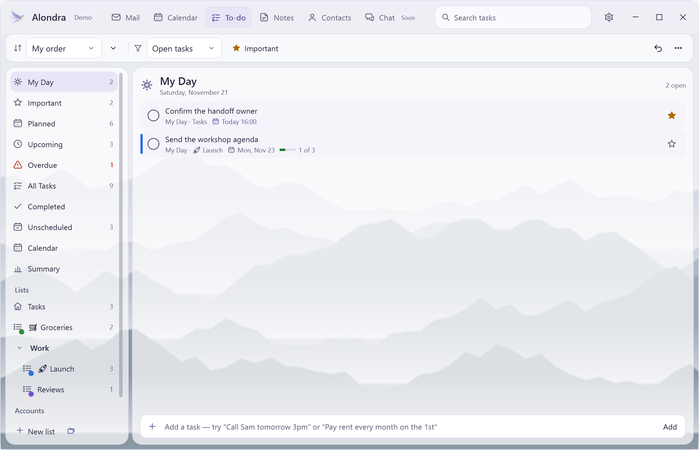
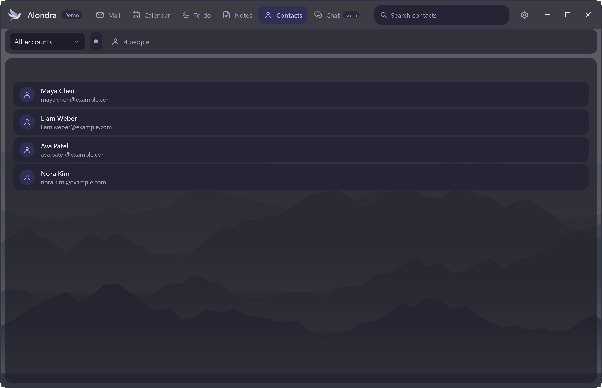

# UI design system

This describes the Alondra1 interface: the two-row shell, design tokens, the Alondra1 icon family, backgrounds, and what is still open.

| Light | Dark |
| --- | --- |
|  |  |
|  |  |
|  |  |

Narrow window (560 px): 

Screenshots are produced by the app itself: `Alondra1.exe --demo --snapshot=<file.png> --exit`, optionally with `--open=<module>`, `--theme=dark`, and `--width=<px>`. They render the window's visual tree, so open popups and menus are not included.

## Shell: two rows above the content

| Row | Height | Contents |
| --- | --- | --- |
| Application header | 56 px | Logo and “Alondra1” wordmark · workspace tabs: Mail, Calendar, To-do, Notes, Contacts, Chat (Soon) · contextual search · Settings · window buttons |
| Module toolbar | 48 px | Mail: Sync button with connection status, folder tabs, New / Reply / Reply all / Forward / Archive / Delete / Mark read or unread, View settings, More. Calendar: Sync button, account selector, month navigation. To-do: sort, filter, important, undo, More. Notes: note selector, New note. Contacts: count. Chat: “Coming later”. |

The old module-navigation row, the “Mail” title, and the account/status text row are gone. Connection status (Up to date, Syncing…, Offline, Sync failed, Sample data, No accounts) is a colored dot with a label inside the Sync button at the start of the toolbar (Mail, Calendar, Notes, Contacts); pressing it syncs every account (F5), and the full text (per account, or the sync summary) is its tooltip and accessible name. Mail chooses its account and grouping (By account, the default, or Together) in View settings, together with folder and reading-pane position and density; Calendar, Notes, and Contacts keep the account selector after the Sync button. Due task reminders float over the content as cards instead of occupying a row.

**Search** is one box whose meaning follows the module: “Search mail”, “Search tasks”, “Search contacts”. Calendar, Notes, and Chat have no search function, so the box is hidden there rather than offering a search that does nothing. Ctrl+E (or Ctrl+F) focuses it; Esc clears it.

**Folders:** with the Layout setting “Folders: Top” (the default) they are tabs in the toolbar. Left, Right, and Bottom still show the dockable folder pane, and Hidden shows a selector in the list header, so all 25 layout combinations keep working and folders are never shown twice.

### Spacing contract

One set of tokens in `Themes/Controls.xaml` governs the shell, the toolbar, and the Mail panes; views reference the tokens instead of literal margins. All values are WPF DIPs.

| Token | Value | Where |
| --- | ---: | --- |
| `ShellOuterInset` (`ShellToolbarMargin`, `ShellContentMargin`) | 10 | window edge → toolbar and content, left, right, and bottom |
| `ShellSurfaceGap` (`ShellSurfaceGapRow`) | 8 | header → toolbar, toolbar → content, and between adjacent panes |
| `PaneContentPadding` (style `ContentPane`) | 16 | inside the message list and reading pane, headers included |
| `PaneHeaderMinHeight` (style `PaneHeaderRow`) | 48 | the “Inbox · view · count” row and the reader's status row |
| `PaneSectionGap` | 12 | pane header row → next region (column row, subject or “No message selected”) |
| `MailTableHeaderHeight` | 32 | From / Subject / Received row |
| `PaneControlGap` | 8 | between controls in one row |
| `ToolbarGroupGap` | 16 | Sync button → account selector; sync/selector → module content is 8 + divider + 8 |
| `ToolbarItemGapRight` | 8 | between folder tabs and other controls inside a toolbar group |
| `ControlMd` | 36 | Sync button, account selector, and folder tabs: one height, one center line |

The shell grid is header 56 · 8 · toolbar 48 · 8 · content. In Mail, `LayoutArranger.Gutter` (8) reserves exactly one gutter between each adjacent pair of panes in all 25 dock combinations; the splitter's hit target is that gutter, so resizing never adds or removes spacing.

Alignment in the Mail panes:

- **List pane:** the folder title starts at the 16 px inset; the view selector and the count form a right-anchored group ending at the 16 px inset. From / Subject / Received and every message row use one column definition (`Controls/MailColumns.cs`), so the labels stay over their columns at any width. Each row reserves a 16 px unread-dot gutter, so “From” lines up with the sender names, not with the title. When the list shows its scroll bar, the column header takes the same right inset.
- **Reading pane:** the status icon, label, and **Plain text** sit in the same 48 px header row as the list's title row; the subject (or “No message selected”) starts 12 px below it. The header row keeps its size with or without a message.
- **Selection** changes only colors (fill and foreground), never font weight, padding, or borders, so tabs and workspace tabs keep their bounds.

### Workspace tabs

The modules in the header are one strip of rounded, browser-style tabs (style `WorkspaceTab`): 36 px high, at least 72 px wide (40 px icon-only), 14 px horizontal padding, 16 px corner radius, 8 px between icon and label, 6 px between tabs, and a 12 px inset around the strip. Inactive tabs are soft blocks (`WorkspaceTabBrush`, a translucent lift over the chrome), hover uses `HoverBrush`, and the active tab is filled with `SelectedBrush` and `BlueBrush` text. No shadow. The “Soon” chip on Chat sits inside the tab without changing its height. The pattern applies only to the header modules, not to folder tabs, To-do views, or selectors.

### Narrow windows

The header and toolbar never wrap into another row. As the window narrows, in this order:

| Window width | Change |
| --- | --- |
| < 1240 | Status label hidden (dot remains, with tooltip) |
| < 1200 | Workspace tab labels hidden (icon-only tabs with tooltips and accessible names) |
| < 1040 | Reply all, Forward, Archive, Mark read move into the toolbar's More menu |
| < 960 | Folder tab labels hidden |
| < 860 | Search collapses to a search button that opens a search box |
| < 760 | Folder tabs become a folder selector |
| < 720 | Notes, Contacts, Chat move into a More menu in the header |
| < 640 | Wordmark hidden (logo stays); account and folder selectors narrow to 100–120 px |
| < 560 | “New” label hidden (icon stays); Calendar and To-do also move into More |

These breakpoints are wider than before the tab strip (labels used to hide at 1120 px, search at 720, overflow at 600 and 470) because the rounded tabs need more room than flat buttons.

The module that is open always stays visible in the header. In To-do, the list sidebar becomes a menu button under 720 px and the details pane floats over the list under 1000 px.

## Tokens

Defined in `apps/windows/src/Alondra1.App/Themes/Controls.xaml` (shape) and `Light.xaml` / `Dark.xaml` (color).

| Radius | Value | Used for |
| --- | --- | --- |
| `RadiusSm` | 8 | chips, thumbnails, small components |
| `RadiusTip` | 8 | tooltips, menu and list rows |
| `RadiusMd` | 10 | buttons, inputs, selectors, active navigation |
| `RadiusLg` | 12 | toolbar, cards, popovers, menus |
| `RadiusXl` | 16 | main panels |
| `RadiusSearch` | 14 | header search |

Spacing follows 4 / 8 / 12 / 16 / 20 / 24 (panel padding 16, field gap 8, section gap 20). Controls: `ControlSm` 30 (compact buttons), `ControlMd` 36 (buttons, inputs, selectors), `ControlLg` 40 (header search, quick add), icon buttons 34 x 34. `HeaderHeight` 56, `ToolbarHeight` 48. Type: 16 titles, 14 body and input text, 13 buttons and list rows, 12 labels and helper text.

| Color token | Light | Dark | Role |
| --- | --- | --- | --- |
| ChromeBrush | #F6F4FA | #16151F | application base (lavender-tinted) |
| SurfaceBrush | #FFFFFF | #1E1D2A | popups, inputs (always opaque) |
| PanelBrush | #FFFFFF | #1E1D2A | main panels; about 69% opaque when a background picture is on |
| HeaderScrimBrush | transparent | transparent | 45% of the base color behind the header when a picture is on |
| SubtleBrush | #FAF9FD | #252434 | toolbar fields, cards |
| TextBrush | #2A2940 | #ECEBF5 | text (deep indigo slate / near white) |
| MutedBrush | #5F5E7A | #A4A3BE | secondary text, inactive icons |
| LineBrush | #E2DFEE | #33324A | borders, dividers |
| HoverBrush | #F0EEF8 | #2A293B | hover |
| SelectedBrush | #E7E5F6 | #302F54 | selection, active navigation |
| BlueBrush | #55569E | #BEBFF2 | accent text and selected icons (deep / light wing lavender) |
| BrandBrush | #6C6DB0 | #6C6DB0 | primary buttons, focus ring, status dot (wing lavender-blue) |
| BrandDarkBrush | #56579A | #7E7FC2 | primary button hover |
| AccentWarmBrush | #F1C2AA | #F4CDB9 | warm accent: icon details, calendar event marks (peach breast) |
| Danger / Success / Star | | | errors and overdue / completion / importance (unchanged; they carry meaning, not branding) |

The palette comes from the Alondra1 bird logo: wings #9397C4 to #D8D5EB, breast #F9DCCE, ground #FCF6F7. The logo's own lavender is too light for white button text (about 2.5:1), so brand fills use a deeper #6C6DB0 (4.7:1 with white), and accent text uses #55569E in the light theme (5.4:1 on the selected color). `UiDesignTests` checks WCAG contrast for text, muted text, accents, and button text in both themes.

Restyled controls: buttons (quiet, icon, primary, navigation, mode), text boxes, search, selectors (rounded box, chevron, rounded drop-down), context menus and submenus, tooltips, check boxes, list rows, and slim scroll bars. Custom colors from Settings → Edit light/dark colors still override any token.

## Alondra1 icon family

`Themes/Icons.xaml` holds 62 icons as SVG path data on a 24 × 24 viewBox. `Controls/Alondra1Icon.cs` draws them at 16, 20, or 24 px with a 1.75 px round-capped stroke in the current text color, so hover, selected, disabled, and theme changes apply automatically. Some icons add a small yellow accent (Calendar, Notes, Sun, Image). Icons are decorative; the containing button carries the accessible name and tooltip.

| Group | Icons |
| --- | --- |
| Modules | Mail, Calendar, Todo, Notes, Contacts, Chat, Settings, Search |
| Mail | Inbox, Sent, Drafts, Compose, Reply, ReplyAll, Forward, Archive, Delete, Move, Flag, MarkRead, Attachment, Folder, Layout |
| Actions | Refresh, Filter, Sort, More, Add, Edit, Close, Save, Download, Upload, Undo, Copy, Promote, Print, Image, Menu |
| Tasks | Reminder, Recurrence, Check, Priority, PriorityFilled, Sun, Clock, Alert, Chart, List, Home, Unscheduled, Group |
| Navigation | Back, Next, ChevronDown, ChevronUp, ChevronRight |

Remaining font glyphs: the minimize, maximize, and close window buttons deliberately keep the native Windows glyphs. Move and Flag exist in the family but are not in the toolbar because Alondra1 has no move-to-folder or flag action yet. `UiDesignTests` checks every path parses and stays inside the 24 × 24 box, and that every icon name used in the app exists.

## Backgrounds

Settings → Background:

- Gallery: Plain color, Soft blue, Gray geometric, Muted coast, Misty mountains, Minimal architecture, Warm neutral, Dark blue, Ocean, and “My picture” once one is chosen.
- Choose picture… (PNG, JPEG, or WebP up to 25 MB, checked by content, not file name). The picture is decoded, scaled to at most 2560 px, re-encoded as JPEG, and stored in `%LOCALAPPDATA%\alondra1\backgrounds`, so moving or deleting the original does not matter. Remove my picture deletes the stored copy when settings are saved.
- Picture opacity (0–100%), blur (0–40 px), desaturation, brightness (±50%), overlay (0–80%), position, and Cover or Contain.
- Show background on/off and Reset background to default. Defaults: Misty mountains, 85% opacity, 2 px blur, 10% desaturation, cover, center. Settings that still hold the first, very muted defaults (soft blue, 15% / 8 px / 35%) untouched are moved to these; values someone chose are kept.

Changes preview live on the main window; Save settings keeps them, closing Settings without saving restores the previous background and removes any picture copied in that session. Settings persist in `config.json` (`appearance.background`); older config files get the defaults.

The picture sits behind the whole window and shows through the main panels (about 69% opaque) and the header (a 45% scrim of the base color behind the labels). Its brightness adapts to the theme: in dark mode a light picture is darkened toward a 36% average, in light mode a dark picture is lifted toward 72%, so text over it stays readable while the picture keeps its detail. Popups, menus, inputs, and message bodies stay opaque.

The built-in pictures are original artwork drawn for Alondra1 by `apps/windows/design/backgrounds/generate.ps1` (no third-party content) and bundled in the app (about 380 KB in total). Nothing is downloaded at runtime.

## Acceptance checklist

| Criterion | Status |
| --- | --- |
| Logo and “Alondra1” replace the Mail icon and title | Done |
| One header row: branding, module navigation, search, Settings | Done (checked by `UiDesignTests`) |
| Module navigation moved into the header; old row removed | Done |
| Second row: Mail account, folders, and actions | Done |
| Standalone status row removed; status kept | Done (dot, label, tooltip, accessible name) |
| Header ≈ 56–60 px, toolbar ≈ 48–52 px | Done: 56 and 48, measured in the running app |
| Narrow windows: icons and overflow, no extra row | Done (checked at 560 px) |
| Consistent radius tokens on buttons, selectors, panels, inputs, menus | Done; dialogs use the standard Windows frame (see below) |
| Custom Alondra1 icons replace generic primary icons | Done; window buttons keep native glyphs |
| Built-in local backgrounds | Done |
| Custom background: choose, preview, keep, remove, reset | Done |
| Background settings persist and work offline | Done |
| Light and dark themes readable and consistent | Done; contrast checked by tests, both themes inspected in screenshots |
| Mail actions enabled by selection; behavior preserved | Done; same commands and shortcuts |
| Calendar, To-do, Notes, Contacts, Settings audited | Done for the main window and To-do; Settings keeps its form layout with the new controls |
| Keyboard, screen-reader names, focus states | Kept; icon-only buttons have names and tooltips; not tested with a screen reader |
| Spacing contract: 10 px outer inset, 8 px surface gaps, one 8 px pane gutter, 16 px pane padding | Done (tokens, `LayoutArranger.Gutter`; checked by `UiDesignTests` for all 25 dock combinations) |
| Toolbar on one center line, 8 px inside groups, 16 px between groups | Done; checked in snapshots |
| List and reader header rows 48 px; shared mail columns | Done (checked by `UiDesignTests` and snapshots) |
| Rounded browser-style workspace tabs | Done; light, dark, and picture backgrounds inspected at 1400 px; narrow widths 470–1200 px inspected in dark |
| Automated tests pass | 103 passed, 1 skipped (the existing 10 GB mailbox test) |
| No new cloud service, telemetry, or server | None added |

## Limitations

- **Dialogs** (Settings, account, compose) use the standard Windows title bar. On Windows 11 the system rounds their corners; the content uses the new controls, but the dialog frame is not a custom 16 px design.
- **Search in Calendar and Notes** is not offered because those modules have no search function, so a search box that does nothing (“Search events”, “Search notes”) is not shown.
- **Theme-specific backgrounds** (a different picture for light and dark) are not implemented; one background applies to both, and the overlay uses the theme's base color.
- **Sliders** in Settings use the standard Windows look.
- **WebP** pictures need the Windows WebP codec (included in Windows 11; on Windows 10 it is the “WebP Image Extensions” Store package). Without it the picker explains this and nothing changes.
- Screen readers were not used for testing; the accessibility tree was read through UI Automation.
- **Spacing at display scaling** other than 100% (125%, 150%, 200%) and after maximize/restore was not measured; geometry is in DIPs with layout rounding on.
- **Very narrow Mail toolbar:** at about 470 px the folder selector is partly covered by the New button (as it was before the spacing change); the header itself fits.
